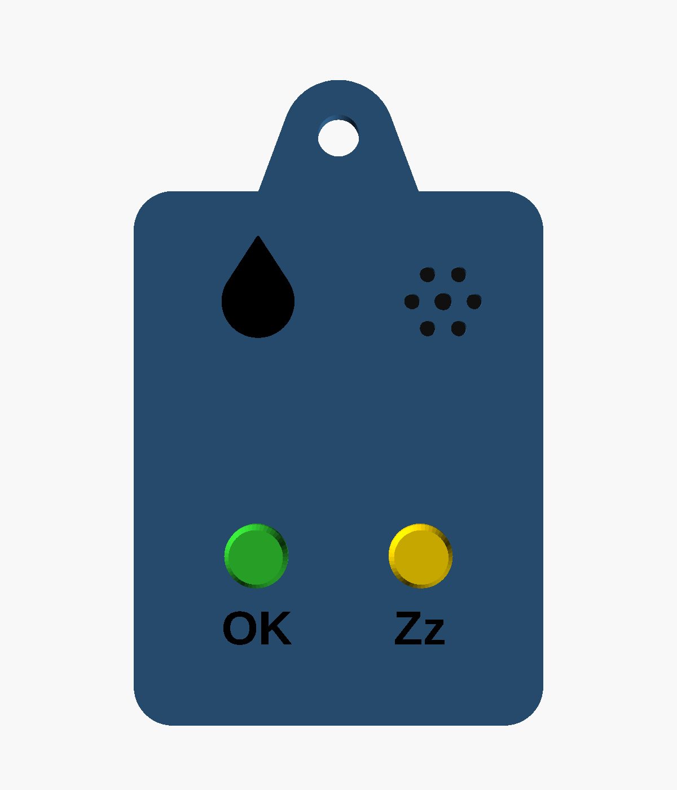
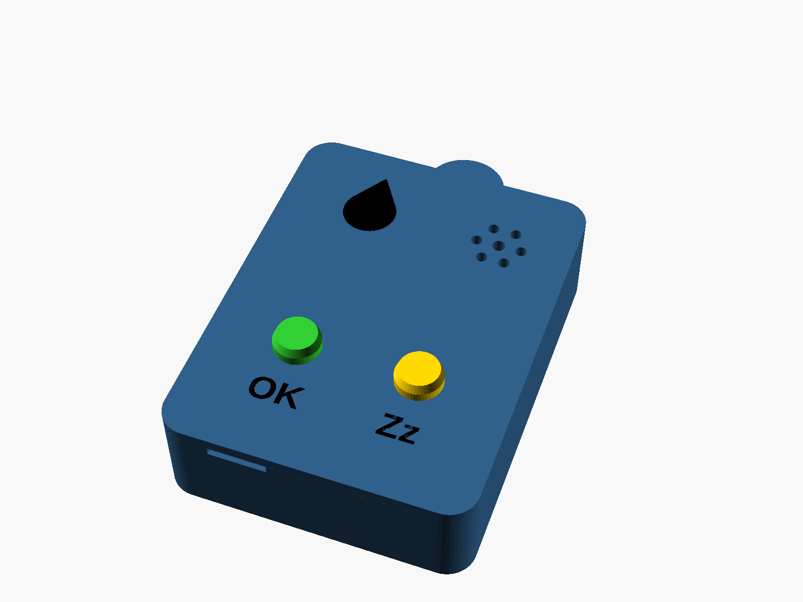
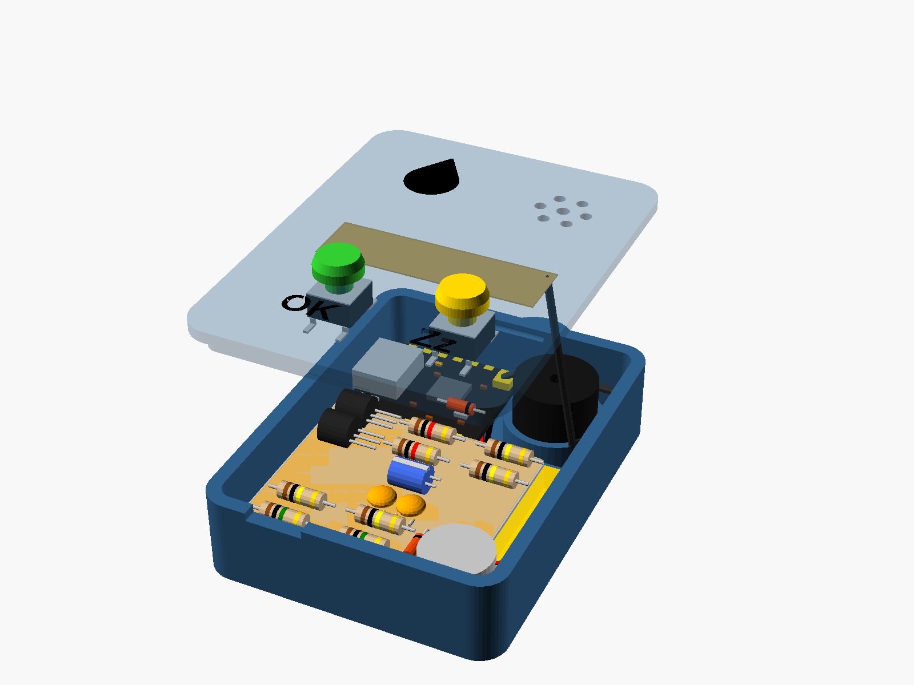
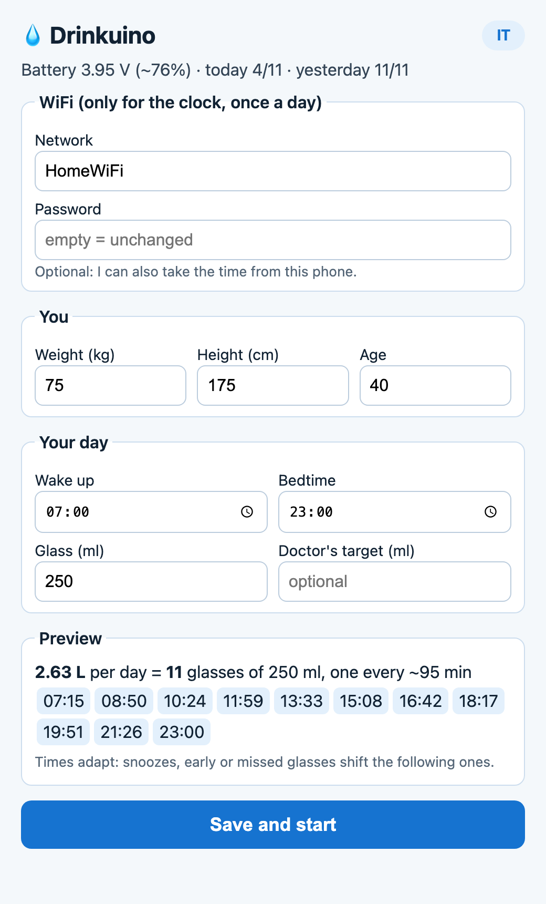

# Drinkuino

<p align="center">
  
</p>

A pendant that reminds you to drink water. Seeed XIAO ESP32C3 + 503035 LiPo, a buzzer, a vibration motor and two buttons.
It spends its life in deep sleep and wakes up only for reminders, for button presses and to sync the clock once a day.

Built for people who must drink regularly, such as kidney stone formers.
Green button = **OK** (I drank), yellow button = **Zz** (snooze).

| Closed | Open |
|---|---|
|  |  |

> **Not a medical device.** Your daily target is your doctor's call: the "doctor's target" field in the setup page overrides the built-in formula.

## Setup page

<p align="center">
  
</p>

Opened from your phone on first power-up, or later by holding **Zz** for 5 seconds. You enter your profile and your day, and the preview shows the reminder times before you save. English and Italian, switchable with the button in the corner.

## Usage

| When | You | It |
|---|---|---|
| Ringing | press **OK** | counts the glass; the next reminder is recomputed |
| Ringing | press **Zz** | rings again in 10 minutes |
| Ringing | nothing | stops after 2 minutes and retries in 10, up to 3 times (never after bedtime) |
| Idle | press **OK** | counts the glass; if the next reminder was within 30 minutes, it is cancelled |
| Any time | hold **Zz** 5 s | reopens the setup page, keeping the settings |
| Any time | hold **OK + Zz** 10 s | factory reset |

Alarm: 15 s of vibration only, then beeps from quietest to loudest over 75 s, then fast beeps.
Three low beeps after an alarm = battery below 3.5 V, charge it.
A three-note tune = daily goal reached: only the bedtime glass is left.

## How reminders are scheduled

- Target: 35 ml/kg (30 ml/kg above age 55), with an adjusted weight if BMI is above 30; at least 2.5 L, at most 4.5 L. The doctor's target replaces the formula.
- First reminder 15 minutes after wake-up.
- Each next reminder: time left until bedtime ÷ glasses still to drink, never less than 20 minutes apart. If you drink on time they are evenly spaced; snoozes, early glasses and missed ones are absorbed automatically.
- The clock syncs over NTP about once a day, after an event has been handled, so it never delays an alarm. Without WiFi it retries every 3 hours and keeps running on its own clock meanwhile.

## Bill of materials

| Part | Qty | Notes |
|---|---|---|
| Seeed XIAO ESP32C3 | 1 | the **C3**, with the included FPC antenna; has a built-in LiPo charger |
| LiPo 503035, ~500 mAh, **with protection circuit (PCM)** | 1 | ≤ 37 × 30 × 5.5 mm including the PCM |
| 12 mm **passive** magnetic buzzer, 3 V | 1 | "passive" / "externally driven", not "active" |
| 1027 coin vibration motor, 3 V | 1 | 10 × 2.7 mm, ~80 mA |
| 6×6×**7** mm THT tactile switch | 2 | round stem |
| Printed button caps | 2 | one in green (OK), one in yellow (Zz) filament; glued on the stems |
| NPN transistor, TO-92 (S8050, 2N2222A, BC337, 2N3904) | 2 | not PNP |
| 1N4148 diode | 2 | |
| Resistors 1/4 W: 1 MΩ ×2, 100 kΩ ×4, 1 kΩ ×2 | | |
| Capacitors: 100 nF ceramic ×2, 10 µF low-profile electrolytic ×1 | | |
| 30 AWG silicone wire, heat shrink, Kapton tape, thin double-sided tape | | |
| 10–12 mm stainless jump ring + **breakaway** lanyard | 1 | a pendant must never be able to choke you |

## Wiring

| What | Connection |
|---|---|
| Battery | red → **BAT+**, black → **BAT−** pads (under the XIAO). Check polarity with a multimeter |
| Battery divider | BAT+ → 1 MΩ → **D2 (GPIO4)** → 1 MΩ → GND; 100 nF between D2 and GND |
| OK button | between **D1 (GPIO3)** and GND; 100 kΩ from D1 to 3V3 |
| Snooze button | between **D3 (GPIO5)** and GND; 100 kΩ from D3 to 3V3 |
| Buzzer | 3V3 → buzzer → NPN1 collector, emitter to GND; base ← 1 kΩ ← **D4 (GPIO6)**, 100 kΩ base → GND; 1N4148 across the buzzer (cathode to 3V3) |
| Motor | same as the buzzer, with NPN2 and **D5 (GPIO7)** |
| Bulk capacitors | 10 µF + 100 nF between 3V3 and GND, close to buzzer and motor |

The buttons sit on GPIO3/GPIO5 because only GPIO0–5 can wake the ESP32-C3 from deep sleep; no strapping pins (2, 8, 9) are used.

## What each part is for

### Switching the buzzer and the motor: transistor + 2 resistors + diode

An ESP32 pin can source about 20 mA; the motor and a magnetic buzzer need 35–80 mA. So the pin drives a transistor, and the transistor switches the load.

```
 3V3 ──┬──────────┐
       │          │
     [buzzer]   [diode]  ← cathode (band) to 3V3
       │          │
       ├──────────┘
       │
       C
 D4 ──[1k]──B   NPN
       │    E
     [100k] │
       │    │
 GND ──┴────┴──
```

- **NPN transistor**: a switch you control with a small current. A trickle into the base (B) lets the big current flow from collector (C) to emitter (E), through the buzzer. Like a relay, but fast enough to follow the PWM.
- **1 kΩ on the base**: limits the current drawn from the pin (about 2.6 mA, enough to turn the transistor fully on).
- **100 kΩ from base to ground**: keeps the transistor off while the pin is floating (at power-on, in deep sleep). Without it you may get random beeps or buzzes.
- **1N4148 across the load**: the buzzer and the motor contain a coil. Cut the current and the coil fires back a voltage spike that can kill the transistor; the diode gives that spike a safe path. **Band towards 3V3**: the other way round it is a short circuit.

### Buttons: 100 kΩ pull-ups

Pressed, a button pulls its pin to 0 V. Released, the pin would be connected to nothing and read random values: the resistor to 3V3 holds it high. They are external because the chip's internal pull-ups may not stay active in deep sleep, and the high→low edge is exactly what wakes the chip. The high value wastes little: 0.03 mA while pressed.

### Measuring the battery: 1 MΩ + 1 MΩ divider and 100 nF

The battery reaches 4.2 V; the analog input reads up to about 2.5 V. Two equal resistors in series halve the voltage (4.2 V → 2.1 V) and the firmware multiplies by 2. High values because the divider is always connected: it draws 0.002 mA. The **100 nF** is a local reservoir for the small gulp of current the ADC takes when sampling, so readings are stable.

### Stable power: 10 µF + 100 nF on 3V3

When the motor starts it draws a current spike that can make 3V3 dip for an instant and reset the ESP32 (brownout). The two capacitors, close to buzzer and motor, are instant reserves: the 10 µF covers slower spikes, the 100 nF fast noise. **The 10 µF electrolytic is polarized**: the "−" stripe goes to ground.

### In short

| Part | Job | Without it |
|---|---|---|
| NPN | power switch | overloaded pin |
| 1 kΩ (base) | limits pin current | overloaded pin |
| 100 kΩ (base → GND) | transistor off by default | random beeps or buzzes at power-on |
| 1N4148 | path for the coil spike | transistor dies over time |
| 100 kΩ (buttons → 3V3) | well-defined "not pressed" | phantom wake-ups, drained battery |
| 1 MΩ + 1 MΩ | halves the battery voltage | ADC out of range or damaged |
| 100 nF (ADC) | reservoir for the reading | jumpy readings |
| 10 µF + 100 nF (3V3) | reserve for spikes | resets when the motor starts |

### Assembly notes

- **Transistor pinout** changes between models (2N2222A and 2N3904 are usually E-B-C, BC337 C-B-E, looking at the flat side; S8050 depends on the maker). Check with a multimeter in diode mode: red probe on the base, the other two pins read about 0.6–0.7 V, the collector slightly less than the emitter.
- **Buzzer frequency**: set `BUZZER_FREQ` in `src/config.h` to your buzzer's resonant frequency (datasheet or listing, often 2048 or 2700 Hz). Off resonance it is much quieter.

## Flashing

1. Install the **PlatformIO IDE** extension in VS Code and open this folder.
2. Connect the XIAO with a USB-C **data** cable.
3. `pio run -e xiao -t upload` (or the → button in the PlatformIO toolbar).
4. Logs: `pio device monitor`. In deep sleep the chip disappears from USB: that is expected.
   If the upload does not start: hold BOOT, press and release RESET, release BOOT.

Debug logging is enabled by `-D DRINK_DEBUG` in `platformio.ini`; remove it once everything works.

Unit tests for the reminder logic run on your computer: `pio test -e native`.

## First setup

1. On first power-up it beeps twice and opens the WiFi network **Drinkuino-XXXX**, password **bevimi123** (change `AP_PASSWORD` in `src/config.h`).
2. Join it with your phone: the setup page opens by itself (otherwise go to http://192.168.4.1).
3. Enter weight, height, age, wake-up time, bedtime, glass size, optionally your doctor's target and your home WiFi. The preview shows the reminder times.
4. **Save**: the clock is set from the phone, then the device restarts. If WiFi is configured but does not work, it plays two low tones.

The portal closes after 10 minutes without activity; any button reopens it. The setup page is in English and Italian: it follows the phone's language, and the button in the top-right corner switches it.

## 3D model

`drinkuino_case.scad` (OpenSCAD): `part="assembly"` for the preview with every component in place (`lid_lift=0` closes it), `"base"`, `"lid"` and `"caps"` for the STLs. Outer size 42 × 55 × 14 mm plus the lug. Print in PETG, no supports.

```
openscad -o base.stl -D 'part="base"' drinkuino_case.scad
openscad -o lid.stl  -D 'part="lid"'  drinkuino_case.scad
openscad -o caps.stl -D 'part="caps"' drinkuino_case.scad
```

The drop and the OK / Zz labels are engraved 0.6 mm into the lid. To make them black:
- **multi-material printer** (AMS, MMU…): also export `-D 'part="inlay"'`, load it together with `lid.stl` as a part of the same object, and assign black filament to it. It fills the engravings flush with the surface;
- **single-extruder printer**: fill the engravings with a black paint marker or acrylic paint, then wipe the surface with a damp cloth.

The caps file holds both caps: print it twice (green and yellow) or split it in the slicer and assign a filament to each. Each cap slips on a 3.5 mm stem and rests about 0.6 mm above the lid, so the switch travel is free; fix it with a drop of glue. If the socket is too tight or too loose, adjust `cap_fit`.

## License

- Firmware, tests and documentation: [MIT](LICENSE).
- 3D model (`drinkuino_case.scad` and the STLs generated from it): [CC BY 4.0](https://creativecommons.org/licenses/by/4.0/) — free to use, modify and share, including commercially, as long as you credit the author.

Provided as is, with no warranty: see the medical disclaimer at the top.
